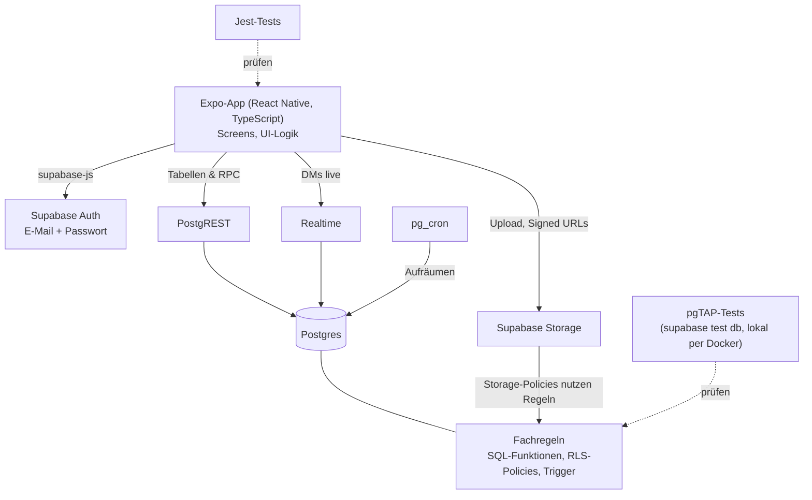
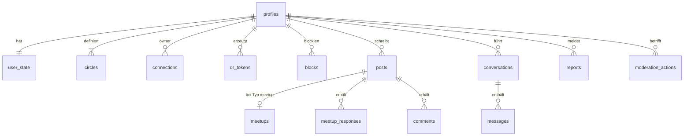

# Architektur: U social

## Skizze

Die App ist bewusst dünn: Es gibt kein eigenes Backend. Die Fachregeln liegen
als SQL-Funktionen, RLS-Policies und Trigger in Postgres (Supabase) und werden
als Migrations im Repository versioniert. So gelten sie für jeden Zugriff –
auch an der App vorbei – und werden genau dort getestet, wo sie laufen.

## Datenmodell

| Tabelle | Wichtige Spalten | Anmerkung |
| --- | --- | --- |
| `profiles` | id (= auth.users.id), display_name, bio, pronouns, avatar_path, favorite_photo_path, is_admin | Anzeigename nicht eindeutig; `is_admin` für Nutzer nicht änderbar |
| `user_state` | user_id, feed_seen_at | getrennt vom Profil, weil Freunde das Profil lesen dürfen |
| `circles` | owner_id, level (1–3), name | Standardnamen Close Friends / Friends / Bekannte, umbenennbar |
| `connections` | owner_id, friend_id, circle_level, connected_at | gerichtet, zwei Zeilen pro Freundschaft; nur `owner_id = auth.uid()` lesbar |
| `qr_tokens` | token_hash, user_id, expires_at, used_at | rotiert alle 30 s |
| `blocks` | blocker_id, blocked_id | löscht bestehende Verbindungen |
| `posts` | id, author_id, type, body, media_path, max_circle, duration_hours, created_at, expires_at, hidden_at | Typen: text, image, video, audio, meetup |
| `meetups` | post_id, location_name, starts_at | Zusatzdaten für Treffen-Posts |
| `meetup_responses` | post_id, user_id, response | Zusagen für alle sichtbar, Absagen nur für den Autor |
| `comments` | id, post_id, author_id, body, created_at, hidden_at | sichtbar für alle, die den Post sehen |
| `conversations` | id, user_a, user_b | eine pro Paar |
| `messages` | id, conversation_id, sender_id, body, media_path, reply_to_post_id | `reply_to_post_id` für „als DM antworten“ |
| `reports` | reporter_id, target_type, target_id, reason, snapshot, status | eindeutig je Melder und Ziel; Snapshot sichert Beweise |
| `moderation_actions` | admin_id, user_id, action, report_id, created_at | warn / delete_content / delete_account |

Storage-Buckets: `avatars` (für Verbundene lesbar), `media` (Pfad
`author_id/post_id/datei`, Lesen nur bei `can_see_post`), `evidence` (nur Admins).

Fachregeln als Datenbankobjekte: `can_see_post()`, Prüfung der Ablaufdauer auf
`posts`, `connect_via_qr()` als RPC, Trigger auf `reports` für das automatische
Ausblenden. Zeitabhängige Funktionen bekommen einen Parameter `p_now` (Standard
`now()`), damit Grenzfälle exakt testbar sind.

## Technologie-Stack

| Bereich | Wahl |
| --- | --- |
| Sprache | TypeScript (App), SQL / PL/pgSQL (Fachregeln) |
| Framework | Expo (React Native) mit Expo Router |
| Datenbank | Supabase (Postgres, Auth, Storage, Realtime) |
| Tests | pgTAP über `supabase test db` (lokal per Docker), Jest für UI-Logik |
| Linter/Formatter | ESLint, Prettier |
| CI | GitHub Actions |
| Build | EAS Build (APK) |

## Entscheidungsprotokoll

| Datum | Entscheidung | Begründung | Alternative (z. B. Agenten-Vorschlag) |
| --- | --- | --- | --- |
| 08.11.2026 | Expo (React Native) statt React-Web-App | Kamera, Audio, Video und eine installierbare App sind für eine Freundes-App zentral | Ursprüngliche Idee: React + Vercel als Web-App |
| 08.11.2026 | Kein eigenes Backend, Fachregeln in Postgres (SQL-Funktionen, RLS, Trigger) | Ein Ort der Wahrheit; Regeln gelten auch für Zugriffe an der App vorbei | Eigener Node-Server mit API |
| 08.11.2026 | Fachregeln mit pgTAP gegen lokales Supabase testen | Getestet wird die echte Implementierung, nicht eine Nachbildung | **Agenten-Vorschlag verworfen:** Regeln zusätzlich als reinen TypeScript-Code mit Mock-Daten testen – hätte nur eine Kopie geprüft, die von der echten Regel abweichen kann |
| 08.11.2026 | Gerichtete Verbindungen (zwei Zeilen pro Freundschaft) | Geheime Einsortierung wird per RLS in der Datenbank erzwungen | Eine Zeile mit zwei Kreisspalten – dann wäre die fremde Einsortierung lesbar |
| 08.11.2026 | Drei feste, umbenennbare Kreise | Ein Schichtenmodell ist einfacher als frei definierbare Gruppen | Beliebig viele Gruppen (vgl. Google+ Circles) |
| 08.11.2026 | Ablaufdauer nur 24 h / 72 h / 7 Tage | 12 h würde FOMO und ständiges Nachsehen fördern | 12 h als zusätzliche Option |
| 08.11.2026 | Login per E-Mail + Passwort | Einfach, Test-Accounts leicht anlegbar | Magic Link, Social Login |
| 08.11.2026 | Anzeigename nicht eindeutig, kein @handle | Verbinden nur per QR, daher keine Suche nötig | Eindeutige Nutzernamen |
| 08.11.2026 | Freund entfernen löscht beide Richtungen | Keine „halben“ Freundschaften | Einseitiges Entfernen |
| 08.11.2026 | Privates Archiv: Medien eigener Posts bleiben erhalten | Gewünschtes Feature; Speicherverbrauch wächst dadurch bewusst | Medien nach Ablauf löschen |
| 08.11.2026 | Supabase-CLI als devDependency | Gleiche Version für Team und CI | Globale Installation |
| 08.11.2026 | Repository auf GitHub, CI über GitHub Actions | Mit dem Dozenten abgesprochen | Nordakademie-GitLab mit `.gitlab-ci.yml` |
| 08.11.2026 | Endpunkt ist eine APK, keine Store-Verteilung | Reicht für Prüfung und Tests | App Store / Play Store |
